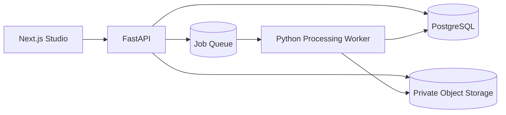

# Technical architecture — DRAFT MVP

## Chosen shape
One Next.js app + one FastAPI service + independent background worker, PostgreSQL and private object storage. Redis queue only when running asynchronous jobs outside local prototype; no microservices required.

## Boundaries
- Web handles upload, workflow navigation, canvas display and authenticated UI.
- API owns authorization, project/revision state, upload validation, job scheduling and download access.
- Worker owns segmentation, palette, region topology, QC, label placement and export generation.
- Database stores metadata, stable IDs, revision and export manifest, *not* binary image blobs.
- Object storage holds original, processed raster, intermediate masks when required and production exports with private access.

## Generation state machine
queued → processing → completed OR failed OR cancelled. Finished results create immutable revisions; manual edits generate a new draft revision. Approved revisions are frozen.

## Minimal deployment
Local: Docker Compose for API, DB, worker, optional Redis, local MinIO/object store. Production: VPS for API/workers if GPU not required, or separate worker host for heavier models; avoid assuming CPU-only inference SLA without benchmarking.

## Core ADRs to settle
Model/checkpoint + licence, local/cloud inference, auth requirement MVP, storage retention, image upload cap, print PDF engine, edit patch representation.
